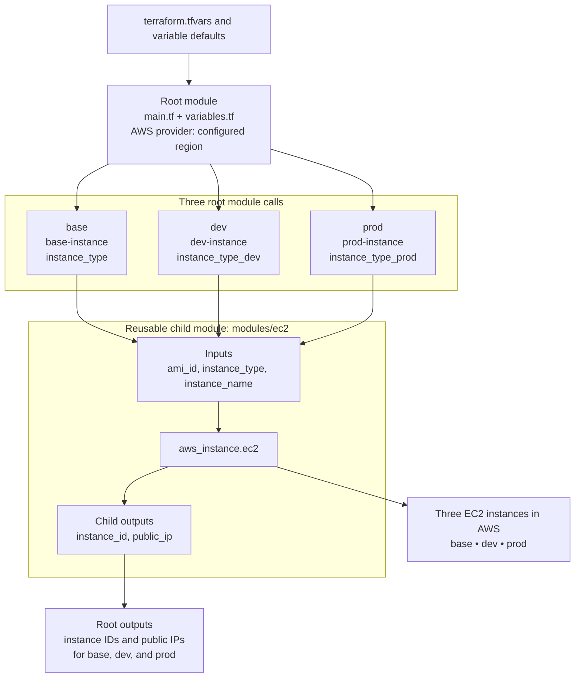

# Terraform AWS EC2 Modules

This project demonstrates how to define one reusable Terraform child module and call it multiple times from a root module. The current configuration provisions three independent Amazon EC2 instances named **base**, **dev**, and **prod** in the AWS region configured by `aws_region` (currently `us-east-1`).

> **Cost reminder:** `terraform apply` creates billable AWS resources. Run `terraform destroy` when you have finished with the lab.

## Architecture



The root module configures the AWS provider and passes the AMI ID, instance type, and instance name into three instances of the same `modules/ec2` module. The child module creates one `aws_instance` resource and returns its instance ID and public IP. Root outputs expose those values for each environment.

## Repository structure

```text
.
├── main.tf                  # AWS provider and base/dev/prod module calls
├── variables.tf             # Region, AMI, and environment instance types
├── terraform.tfvars         # Example input values
├── outputs.tf               # Outputs for all three instances
├── modules/
│   └── ec2/
│       ├── main.tf          # Reusable aws_instance resource
│       ├── variables.tf     # Child-module inputs
│       └── outputs.tf       # Child-module outputs
├── diagrams/
│   └── architecture.mmd     # Editable Mermaid architecture source
├── script.sh                # Convenience initialization/plan/apply script
└── git-push.sh              # Git helper script
```

## What gets created

| Module call | EC2 Name tag | Instance type |
| --- | --- | --- |
| `base` | `base-instance` | `var.instance_type` (default: `t2.micro`, overridden in the checked-in tfvars) |
| `dev` | `dev-instance` | `var.instance_type_dev` (default: `t3.medium`) |
| `prod` | `prod-instance` | `var.instance_type_prod` (default: `t3.large`) |

All three calls use the same `ami_id`. Choose an AMI that exists in the selected AWS region and is compatible with your account and instance requirements. The EC2 resource in this project does not define a VPC, subnet, security group, key pair, IAM role, or user data; networking and access therefore depend on AWS/provider defaults and the selected AMI.

## How module inputs and outputs flow

1. Root variables are declared in `variables.tf`; values can come from defaults, `terraform.tfvars`, environment variables, or command-line arguments.
2. The root module in `main.tf` invokes `./modules/ec2` three times and passes each child module its AMI, instance type, and name.
3. The child module creates one `aws_instance` and exposes `instance_id` and `public_ip`.
4. Root `outputs.tf` publishes the corresponding values for base, dev, and prod.

## Prerequisites

- Terraform CLI installed
- AWS account and credentials available through the AWS provider's standard credential chain (for example, an AWS profile or environment variables)
- An AMI ID valid in the configured region
- IAM permissions to manage EC2 instances and the related resources required by your AWS account defaults

Do not commit AWS access keys or other credentials to this repository.

## Configure

Review `terraform.tfvars` and `variables.tf`. The repository currently sets:

- Region: `us-east-1`
- AMI: `ami-096ef200a877f36af`
- Base instance type: `t3.micro`
- Dev instance type: `t3.medium`
- Prod instance type: `t3.large`

AMI IDs are region-specific and may become unavailable; replace the example with a current AMI for your region when needed.

### Configuration warning

The checked-in `terraform.tfvars` contains `instance_name`, but the root module does not declare or use a root variable with that name. Terraform reports an **undeclared variable** warning and ignores that value. The names are currently set directly in the three module calls in `main.tf`. To remove the warning, delete the unused `instance_name` line from `terraform.tfvars`, or change the Terraform configuration to declare and use that variable.

## Run

From the repository root:

```bash
terraform init
terraform fmt -recursive
terraform validate
terraform plan
terraform apply
```

Review the plan before applying. Terraform should plan three EC2 instances when none exist. To inspect the values after apply:

```bash
terraform output
terraform output base_instance_id
terraform output base_public_ip
terraform output dev_instance_id
terraform output dev_public_ip
terraform output prod_instance_id
terraform output prod_public_ip
```

Destroy the resources when they are no longer needed:

```bash
terraform destroy
```

The helper `script.sh` automates initialization, validation/planning, and apply. Read the script before running it because it applies infrastructure and can incur AWS charges.

## Reuse the module

The module can be extended by adding another module call in root `main.tf`, passing the required `ami_id`, `instance_type`, and `instance_name` inputs, and adding root outputs if you want to expose that instance's values.

## License

See [LICENSE](LICENSE).
